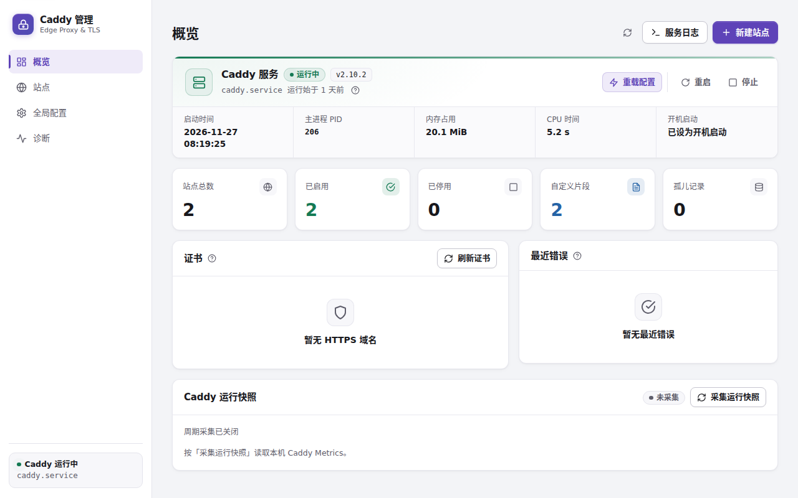
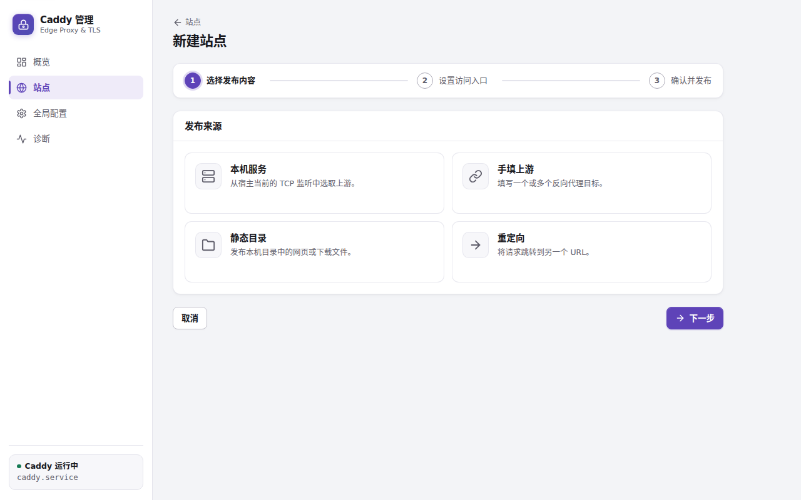

<div align="center">
  
  <h1>Caddy Manager</h1>
  <p><strong>Caddy, managed safely from your browser.</strong></p>
  <p>A self-hosted Caddy reverse proxy and site management panel, delivered as an Extension Host / GoDesk extension.</p>
  <p>
    <a href="https://github.com/EziosWJ/ext-caddy-manage/releases/tag/v0.1"></a>
    <a href="LICENSE"></a>
    <a href="https://github.com/EziosWJ/Extension-Host">= 0.1.0"></a>
    <a href="https://github.com/EziosWJ/ext-caddy-manage"></a>
  </p>
  <p>English · <a href="README.zh-CN.md">简体中文</a></p>
</div>



Caddy Manager (plugin id `de.jianwang.caddy-manage`) adds a lightweight site abstraction on top of Caddy: manage static sites, reverse proxies, and redirects with forms while keeping full control of the underlying Caddyfile. The pure-Lua backend has no external Lua dependencies, and the frontend is a no-build ES module app.

The configuration files are the single source of truth; SQLite only stores UI metadata and form snapshots. Every write is serialized: snippet validation → backup → atomic write → whole-config validation → hot reload, with automatic rollback on failure.



## Features

- **Sites** — Static sites (root, directory browsing, SPA fallback), reverse proxies (multiple upstreams, load balancing, health checks, Host header, TLS skip-verify, timeouts), and redirects. Multiple domains, enable/disable, groups and notes, plus detection of hand-written snippets.
- **Configuration** — Managed global block (ACME email, staging, extra global directives) and raw Caddyfile editing; site forms and raw snippets coexist. Formatting, validation, conflict detection (`409`), and drift warnings.
- **Safe changes** — `caddy validate` before and after writing, atomic write via same-directory temp file + rename, backups, and automatic rollback when a reload fails.
- **Security** — Basic Auth (bcrypt), compression, HSTS and custom response headers, IP allow/deny, and directory browsing.
- **TLS certificates** — Caddy automatic HTTPS, a staging toggle, and issuer/expiry probing via `openssl` with a configurable cache.
- **Diagnostics** — Structured runtime diagnostics, Caddy Admin `/metrics` snapshots (loopback or Unix socket), access-log summaries, and journald service/site logs with filtering, follow, and export.
- **Service control** — systemd status, start, stop, restart, and validation-first reload through `host.services`.

## Requirements

- Linux host with systemd (Ubuntu 24.04+ recommended).
- Extension Host `>= 0.1.0`, or GoDesk with Extension Host capabilities.
- Caddy `>= 2.8` (2.10.x recommended); the official static binary is assumed to live at `/opt/caddy/caddy`.
- `openssl` and `curl` on the host.
- Optional: a `caddy.service` systemd unit and sudo rules for start/stop/restart. See the [Deployment Guide](deploy/README.md).

## Installation

1. Build or download `de.jianwang.caddy-manage-0.1.0.zip`.
2. Install it in GoDesk under **Extensions**, or open `http://127.0.0.1:5001/host/` for a standalone Extension Host, install the ZIP, and enable it.
3. Configure the host extension settings (binary, main Caddyfile, snippet directory, sites root, service unit, log lines, certificate cache, metrics, backup retention).
4. Open **Diagnostics** and use **Generate initial configuration** if the main Caddyfile does not exist yet, then run an initial reload.

For system preparation (Caddy binary, `caddy` account, `/opt/caddy`, unit, journald, sudoers), follow the [Deployment Guide](deploy/README.md).

## Configuration

All keys live in the host extension configuration form and take effect immediately without restarting the plugin. Directory values are plain strings and are created on first use or from **Diagnostics → Generate initial configuration**.

| Key | Type | Default | Range | Description |
| --- | --- | --- | --- | --- |
| `caddyBinary` | string | `/opt/caddy/caddy` | absolute path | Caddy executable used to validate and reload configurations. |
| `mainConfig` | string | `/opt/caddy/config/Caddyfile` | absolute path | Main Caddyfile that imports the site snippets. |
| `snippetDir` | string | `/opt/caddy/config/conf.d` | absolute path | Active site snippet directory; the disabled directory is `<dir>.disabled`. |
| `sitesRoot` | string | `/opt/caddy/sites` | absolute path | Parent directory for new static site roots. |
| `serviceUnit` | string | `caddy.service` | `*.service` | Unit passed to `host.services.*`. |
| `logLines` | number | 500 | 100–2000 | Default number of recent log lines per request. |
| `certProbeHours` | number | 6 | 1–168 | TLS certificate probe cache TTL in hours. |
| `metricsPeriodic` | boolean | false | true / false | Collect a runtime metrics snapshot every 60 seconds. |
| `backupKeep` | number | 100 | 10–1000 | Maximum number of configuration backups to retain. |

Paths must be absolute host paths. Invalid values fall back to the defaults and are reported on the diagnostics page. Changing `sitesRoot` only affects sites created afterwards.

## Limitations & Security

### Limitations

- No TCP/UDP layer-4 proxying, rate limiting, DNS-01 form, or manual certificate upload.
- Caddy's `reverse_proxy` requires upstreams to be either all bare (`host:port`) or all explicitly using the same scheme; mixed forms are rejected.
- A Caddyfile that is itself a symlink is read-only: writing, moving, or deleting it is refused. A configuration directory may be a symlink to a directory.
- No FastCGI/PHP, file manager, containers, multi-user/RBAC, access history or long-term statistics, site renaming, or multiple Caddy instances.
- Site logs are derived from the unit's most recent N lines; a high-traffic neighbor can push a quiet site's older lines out of the window.
- Certificate probing requires the domain to resolve to the host and port 443 to be reachable; otherwise the certificate is shown as unknown.
- Configuration drift is never merged automatically — choose **Use disk contents** or **Overwrite with form**.
- The Lua runtime is single-goroutine: `exec` and certificate probes briefly block the plugin's other requests, though every call has an explicit timeout.
- Requires Caddy `>= 2.8` (`basic_auth`, `hash-password` stdin, `fmt -`, `validate --config -`).

### Security

- A standalone host listens only on loopback and has no login; do not expose it directly to the internet. Put remote access behind an authenticated reverse proxy.
- The plugin acts only through the Host API. Sudoers should allow exactly the `systemctl start/stop/restart caddy.service` commands — never a wildcard.
- Caddy runs as a dedicated `caddy` user and can only read configuration and site directories (`0755`/`0644`).
- Writes use a same-directory temp file plus `os.rename`; every change is backed up first, and a failed validation or reload rolls back and reports the backup.
- Passwords, plaintext hash input, and full models are never written to logs. Basic Auth bcrypt hashes do appear in snippets, SQLite model snapshots, and backups, so treat them as secrets.
- Backups live in the host plugin data directory with mode `0700`; backup files are `0600`.

## Development & Verification

Prerequisites: Go toolchain (to build the host), Caddy >= 2.8 for local runs, and an Extension Host with `host.services` sudo support. The frontend needs no build step or Node.

```sh
ext dev                      # install and enable the current plugin, update on save (data in .ext/)
ext pkg                      # build dist/de.jianwang.caddy-manage-0.1.0.zip
ext validate --strict .      # validate the extension manifest and package paths
```

End-to-end checks run against a real host and Caddy binary, without root or systemd:

```sh
bash scripts/e2e.sh
python3 scripts/e2e-diag.py --caddy /opt/caddy/caddy --resources
```

`e2e.sh` builds a temporary host, downloads Caddy (or uses a local binary), and covers initialization, site creation, validation, reload, conflict `409`, enable/disable, deletion, backup restore, and formatting. `e2e-diag.py` installs the current ZIP, reinstalls it to verify data survives a self-upgrade, then covers diagnostics, backups, metrics, journal windows, and reload rollback. Pass `--serve` to keep the fixture running for browser checks.

## Documentation & License

- [Deployment Guide](deploy/README.md) — system account, directories, systemd, journald, sudoers, installation, upgrades, troubleshooting.
- [Design Document](docs/design.md) — architecture, data model, change flow, HTTP API, and design decisions.

Released under the [MIT License](LICENSE).
