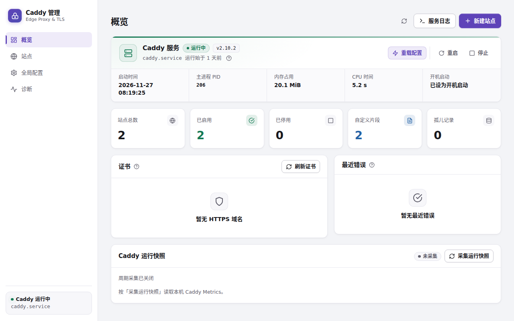
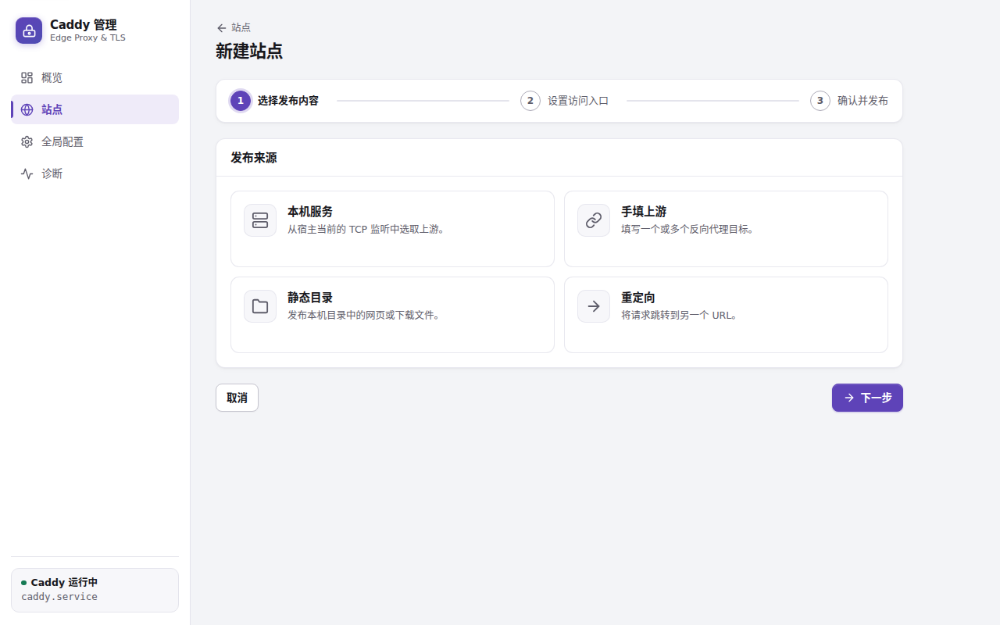

<div align="center">
  
  <h1>Caddy 管理</h1>
  <p><strong>在浏览器里，安全地管理 Caddy。</strong></p>
  <p>一个自托管的 Caddy 反向代理与站点管理面板，以 Extension Host / GoDesk 插件形式运行。</p>
  <p>
    <a href="https://github.com/EziosWJ/ext-caddy-manage/releases/tag/v0.1"></a>
    <a href="LICENSE"></a>
    <a href="https://github.com/EziosWJ/Extension-Host">= 0.1.0"></a>
    <a href="https://github.com/EziosWJ/ext-caddy-manage"></a>
  </p>
  <p><a href="README.md">English</a> · 简体中文</p>
</div>



Caddy 管理（插件 id `de.jianwang.caddy-manage`）在 Caddy 之上提供轻量的「站点」抽象：用表单管理静态站、反向代理和重定向，同时保留对底层 Caddyfile 的完整控制。后端为纯 Lua，无外部 Lua 依赖；前端为无构建步骤的 ES 模块应用。

配置文件是唯一真源，SQLite 只存 UI 元数据与表单快照。所有写操作串行执行：片段校验 → 备份 → 原子写入 → 整体校验 → 热重载，失败自动回滚。



## 功能

- **站点**：静态站（根目录、目录浏览、SPA 回退）、反向代理（多上游、负载均衡、健康检查、Host 头、TLS 跳过校验、超时）与重定向；多域名、启用/停用、分组与备注，并能识别手写片段。
- **配置**：受管全局块（ACME 邮箱、staging、额外全局指令）与主 Caddyfile 原文编辑；站点表单与原文片段并存；支持格式化、校验、冲突检测（`409`）和漂移提示。
- **安全变更**：写入前后均执行 `caddy validate`，通过同目录临时文件 + rename 原子写入，变更前自动备份，重载失败自动回滚。
- **安全项**：Basic Auth（bcrypt）、压缩、HSTS 与自定义响应头、IP 允许/拒绝、目录浏览。
- **TLS 证书**：Caddy 自动 HTTPS、staging 开关，以及通过 `openssl` 探测签发者和到期时间并缓存。
- **诊断**：结构化运行诊断、Caddy Admin `/metrics` 快照（回环地址或 Unix socket）、访问日志摘要，以及可按条件过滤、跟随和导出的 journald 服务/站点日志。
- **服务控制**：通过 `host.services` 查询 systemd 状态，并执行启动、停止、重启与先校验后重载。

## 环境要求

- Linux 主机与 systemd（推荐 Ubuntu 24.04+）。
- Extension Host `>= 0.1.0`，或具备 Extension Host 能力的 GoDesk。
- Caddy `>= 2.8`（推荐 2.10.x）；默认使用位于 `/opt/caddy/caddy` 的官方静态二进制。
- 主机需安装 `openssl` 与 `curl`。
- 可选：`caddy.service` systemd 单元，以及用于启动/停止/重启的 sudo 规则。详见[部署手册](deploy/README.md)。

## 安装

1. 构建或下载 `de.jianwang.caddy-manage-0.1.0.zip`。
2. 在 GoDesk 的「扩展」中安装；独立 Extension Host 则打开 `http://127.0.0.1:5001/host/`，安装 ZIP 并启用。
3. 配置宿主扩展设置（二进制、主 Caddyfile、片段目录、站点根目录、服务单元、日志行数、证书缓存、运行指标、备份保留）。
4. 打开「诊断」；若主 Caddyfile 尚不存在，点击「生成初始配置」，然后执行一次初始重载。

系统层准备（Caddy 二进制、`caddy` 账号、`/opt/caddy`、unit、journald、sudoers）请按[部署手册](deploy/README.md)操作。

## 配置

所有键都在宿主扩展配置表单中设置，保存后热生效，无需重启插件。目录类配置是普通字符串，在首次使用或「诊断 → 生成初始配置」时创建。

| 键 | 类型 | 默认值 | 范围 | 说明 |
| --- | --- | --- | --- | --- |
| `caddyBinary` | string | `/opt/caddy/caddy` | 绝对路径 | 用于校验和热重载配置的 Caddy 可执行文件。 |
| `mainConfig` | string | `/opt/caddy/config/Caddyfile` | 绝对路径 | 导入各站点配置片段的主 Caddyfile。 |
| `snippetDir` | string | `/opt/caddy/config/conf.d` | 绝对路径 | 启用的站点片段目录；停用目录为 `<dir>.disabled`。 |
| `sitesRoot` | string | `/opt/caddy/sites` | 绝对路径 | 新建静态站点根目录的父目录。 |
| `serviceUnit` | string | `caddy.service` | `*.service` | 传给 `host.services.*` 的服务单元。 |
| `logLines` | number | 500 | 100–2000 | 每次请求默认读取的最近日志行数。 |
| `certProbeHours` | number | 6 | 1–168 | TLS 证书探测结果缓存时长（小时）。 |
| `metricsPeriodic` | boolean | false | true / false | 启用后每 60 秒采集一次运行指标快照。 |
| `backupKeep` | number | 100 | 10–1000 | 保留配置备份的最大数量。 |

路径必须是宿主机绝对路径；非法值会回退默认值并在诊断页提示。修改 `sitesRoot` 只影响之后创建的站点。

## 限制与安全

### 已知限制

- 不支持 TCP/UDP 四层代理、限流、DNS-01 表单或手动上传证书。
- Caddy 的 `reverse_proxy` 要求上游全部不带 scheme，或全部显式使用同一 scheme；插件拒绝混合写法。
- 配置文件本身是符号链接时只允许读取，写入/移动/删除会被拒绝；配置目录可以是指向目录的符号链接。
- 不支持 FastCGI/PHP、文件管理、容器、多用户/RBAC、访问历史与长期统计、站点重命名或多 Caddy 实例。
- 站点日志基于整个 unit 的最近 N 行；高流量邻居可能把安静站点的旧行挤出窗口。
- 证书探测依赖域名解析到本机且 443 可达；未上线域名显示为「未知」。
- 配置漂移不会自动合并，必须选择「以磁盘为准」或「用表单覆盖」。
- Lua 单 goroutine：`exec` 与证书探测会短暂阻塞插件自身的其他请求，所有调用都有显式超时。
- 要求 Caddy `>= 2.8`（`basic_auth`、`hash-password` stdin、`fmt -`、`validate --config -`）。

### 安全说明

- 独立宿主默认只监听回环地址且没有登录；不要直接暴露到公网，远程访问请置于带认证的反向代理之后。
- 插件只通过 Host API 执行操作。sudoers 应只允许 `systemctl start/stop/restart caddy.service` 三条完整命令，不要使用通配符。
- Caddy 以专用 `caddy` 账号运行，对配置与站点目录只有读权限（`0755`/`0644`）。
- 写入使用同目录临时文件 + `os.rename`；每次改动先备份，整体校验或重载失败会回滚并报告备份。
- 插件不会在日志中输出密码、明文哈希输入或完整模型；Basic Auth 的 bcrypt 哈希会出现在站点片段、SQLite 模型快照与备份中，应按敏感配置保护。
- 备份目录位于宿主插件数据目录，权限 `0700`；备份文件 `0600`。

## 开发与验证

前置：Go 工具链（构建宿主）、Caddy ≥ 2.8（本地联调），以及支持 `host.services` sudo 选项的 Extension Host。前端无构建步骤，也不需要 Node。

```sh
ext dev                      # 安装并启用当前插件，保存文件后更新（数据在 .ext/）
ext pkg                      # 生成 dist/de.jianwang.caddy-manage-0.1.0.zip
ext validate --strict .      # 校验插件清单与打包路径
```

端到端脚本针对真实宿主与真实 Caddy 运行，不需要 root 或 systemd：

```sh
bash scripts/e2e.sh
python3 scripts/e2e-diag.py --caddy /opt/caddy/caddy --resources
```

`e2e.sh` 在临时目录构建宿主、下载 Caddy（或使用本地二进制），覆盖初始化、新建站点、校验、重载、冲突 `409`、停用/启用、删除、备份恢复与格式化。`e2e-diag.py` 安装当前 ZIP 并重新安装同一包以验证自升级后数据保留，再覆盖诊断、备份、运行指标、日志窗口与重载回滚。传入 `--serve` 可保留测试实例以便浏览器验收。

## 文档与许可证

- [部署手册](deploy/README.md)：系统账号、目录、systemd、journald、sudoers、安装、升级与故障排查。
- [设计文档](docs/design.md)：架构、数据模型、变更流程、HTTP API 与设计决策。

本项目以 [MIT 许可证](LICENSE) 发布。
